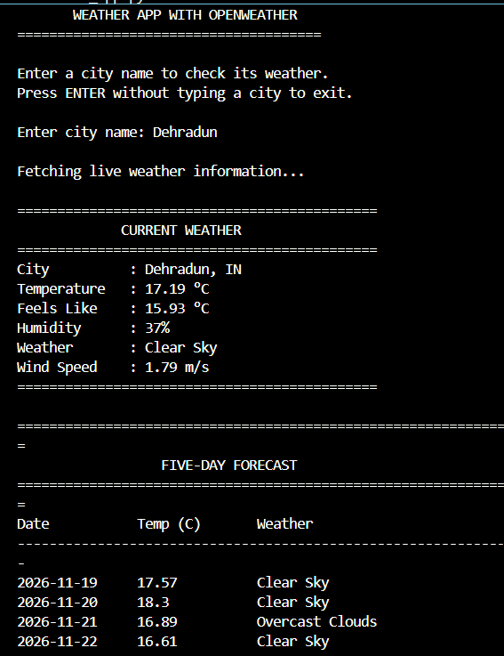

# Weather App with Live OpenWeather API
## Project Overview
This is a Python-based Weather Application that fetches real-time weather information using the OpenWeather API.

Users can enter a city name to view current temperature, humidity, weather conditions, wind speed, and a five-day forecast.

## Features
- Fetch live weather information.
- Display temperature in Celsius.
- Show humidity and wind speed.
- Display weather descriptions.
- Provide a five-day weather forecast.
- Handle invalid city names.
- Handle API and network errors.
- Cache weather results for 10 minutes.
- Securely store the API key using environment variables.

## Technologies Used
- Python
- Requests
- OpenWeather API
- JSON
- Python-dotenv

## Installation

Install the required libraries:

`pip install -r requirements.txt`

## API Key Setup

1. Create a free account on https://openweathermap.org/api.
2. Generate an API key.
3. Create a `.env` file in the project folder.
4. Add the following:

`OPENWEATHER_API_KEY=your_actual_api_key`

Never upload your `.env` file to GitHub.

## How to Run

Execute:

`python weather_app.py`

Enter a city name to view its weather information.

Press Enter without entering a city to exit.

## API Endpoints
- Current Weather: `/data/2.5/weather`
- Five-Day Forecast: `/data/2.5/forecast`

## Security
The API key is stored in a `.env` file and loaded using python-dotenv. The `.env` file is excluded from GitHub using `.gitignore`.

## Author
Meenakshi Bhatt

